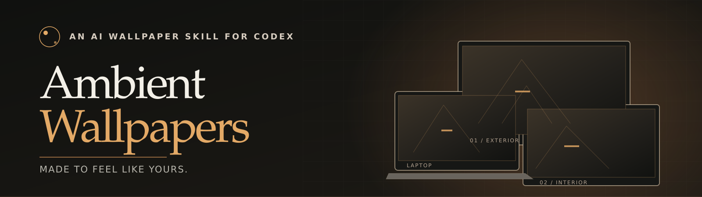
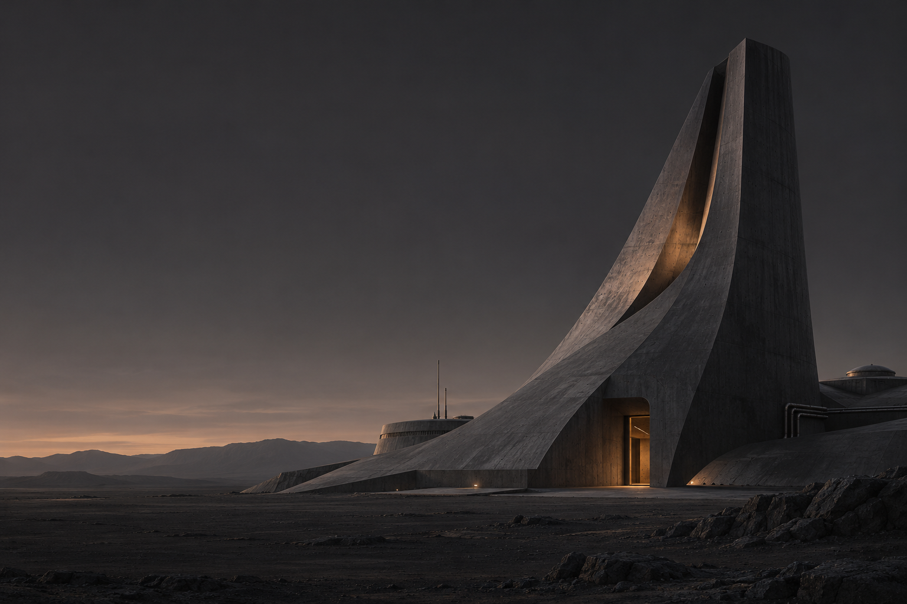
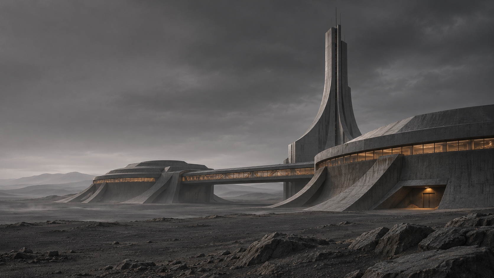

<p align="center">
  
</p>

<p align="center">
  <strong>AI-generated wallpapers shaped by your taste, composed as one visual world across your displays.</strong>
</p>
<p align="center">
  <a href="https://maxlauriehutchinson.github.io/ambient-wallpapers/">Explore the showcase</a> &nbsp;·&nbsp;
  <a href="#get-started">Get the skill</a> &nbsp;·&nbsp;
  <a href="#the-creative-process">See the process</a> &nbsp;·&nbsp;
  <a href="https://github.com/MaxLaurieHutchinson/ambient-wallpapers/actions/workflows/release-readiness.yml">Build status</a>
</p>

<p align="center">
  
  
  
</p>
<p align="center"><sub>THE RESEARCH STATION · ONE ATMOSPHERE · THREE COMPOSITIONS</sub></p>

## Make your desktop feel like yours

A great wallpaper can be more personal than a stock image. **Ambient Wallpapers** is an experimental [Codex skill](skills/ambient-wallpapers/SKILL.md) that starts with an idea of your taste, listens when you disagree, and helps create a coordinated set of wallpapers for the screens you actually use.

The images above are a real example from the project, not a generic image search. Each screen gets its own composition while colour, light and atmosphere connect the whole set.

**[See the full-screen gallery and product showcase →](https://maxlauriehutchinson.github.io/ambient-wallpapers/)**

## The creative process

The research-station collection started with an imperfect guess. The initial mood felt promising; the scenery did not. Feedback pushed it towards architectural forms, graphite surfaces and quiet amber lighting. That direction became a consistent world explored from three viewpoints.

| 01 · Find a direction | 02 · Refine from feedback | 03 · Compose for every screen |
| :-- | :-- | :-- |
| Use preferences as clues, not assumptions. | Keep what fits; change what misses. | Generate related scenes with framing suited to each display. |

It's a small design experiment: *can a wallpaper skill learn enough about your taste to make something that feels distinctly yours?*

## Get started

<text>**What you need:** [Codex](https://openai.com/codex/) with an image-generation tool, Python 3.10+, and [Pillow](https://pypi.org/project/Pillow/) for local preparation. Windows application uses PowerShell; macOS static wallpaper application uses Swift from Xcode Command Line Tools.</text>

### Install the skill

Ask the Codex `$skill-installer` to install the skill directory:

```text
https://github.com/MaxLaurieHutchinson/ambient-wallpapers/tree/main/skills/ambient-wallpapers
```

If your Codex setup does not include the installer, use a manual installation.

<details>
<summary><strong>Manual installation (Windows, macOS and Linux)</strong></summary>

Copy the complete `skills/ambient-wallpapers` folder, including its scripts, references and examples, into your Codex user-skills directory.

**macOS / Linux**

```bash
git clone --depth 1 https://github.com/MaxLaurieHutchinson/ambient-wallpapers.git
mkdir -p "$HOME/.agents/skills"
cp -R ambient-wallpapers/skills/ambient-wallpapers "$HOME/.agents/skills/"
```

**Windows PowerShell**

```powershell
git clone --depth 1 https://github.com/MaxLaurieHutchinson/ambient-wallpapers.git
New-Item -ItemType Directory -Force "$HOME/.agents/skills" | Out-Null
Copy-Item -Recurse -Force "ambient-wallpapers/skills/ambient-wallpapers" "$HOME/.agents/skills/"
```

Codex normally uses `~/.agents/skills/`; older installations may use `~/.codex/skills/`. Restart your Codex session and check its available skills after copying. Replace an existing installation deliberately rather than nesting the folder twice.

</details>

### Ask for your first set

Start a new Codex session:

```text
$ambient-wallpapers make my desktop feel more like me
```

The skill proposes a direction, asks for your feedback, prepares artwork for your displays and offers a plan before making any desktop changes. You stay in control of what gets applied.

**By default, application and recurring tasks are disabled.** Generating or exporting artwork does not authorise modifying a desktop.

## What it can do

- **Personalised direction:** distinguish confirmed tastes, tentative ideas and rejected approaches.
- **Coordinated multi-display art:** make a family of images, not the same image stretched across different screens.
- **Safe desktop application:** inspect, plan, back up, apply and restore static wallpapers on supported Windows and macOS setups.
- **Optional ambient behaviour:** select from approved local packs by time, connected displays or opted-in city weather. Scheduling and agent suggestions require explicit configuration.
- **Honest image quality:** retain source dimensions; resizing or upscaling is not presented as native generated detail.

Linux currently supports generation/export, not wallpaper application. The native macOS adapter passes automated Swift compilation and contract checks, but has not yet completed physical multi-display acceptance testing; dynamic wallpapers and multi-Space restoration are not guaranteed. Read the [macOS guide](skills/ambient-wallpapers/references/macos.md) and [Windows guide](skills/ambient-wallpapers/references/windows.md) before applying wallpapers.

<details>
<summary><strong>Engineering details, local verification and release status</strong></summary>

The skill separates creativity from operating-system mutations. Agents provide **data only**, not permissions; weather uses a city you explicitly choose; schedules require a logged-in local runtime and an available image tool.

Local verification:

```bash
python -m pip install Pillow
python -m unittest discover -s skills/ambient-wallpapers/tests -v
python tools/package_ambient_skill.py --version 0.1.0
python tools/verify_release.py
```

Windows-only non-mutating contracts:

```powershell
pwsh -NoProfile -File skills/ambient-wallpapers/tests/test_windows_roles.ps1
pwsh -NoProfile -File skills/ambient-wallpapers/tests/test_signal_task_plan.ps1
```

CI checks Python tests, Windows contracts, Swift typechecking, deterministic archives and full-history credential scanning. Live wallpaper application and rollback need a separate manual test. The repository is a **v0.1.0 release candidate**; no tagged release has been published yet. Generated ZIPs and a SHA-256 manifest will appear under [GitHub Releases](https://github.com/MaxLaurieHutchinson/ambient-wallpapers/releases) after acceptance.

Read the [skill instructions](skills/ambient-wallpapers/SKILL.md), [security policy](SECURITY.md) and [maintainer release checklist](docs/RELEASING.md).

</details>

---

**Made as a creative experiment, shared as a reusable skill.**

[Explore the showcase](https://maxlauriehutchinson.github.io/ambient-wallpapers/) · [Contribute](CONTRIBUTING.md) · [MIT source licence](LICENSE) · [CC BY 4.0 example-artwork terms](ASSETS-LICENSE.md)

<sub>Example artwork was generated using Codex for this project. The artwork terms apply only to the six listed example and showcase image paths; wallpapers you create or supply have their own provenance and rights.</sub>
